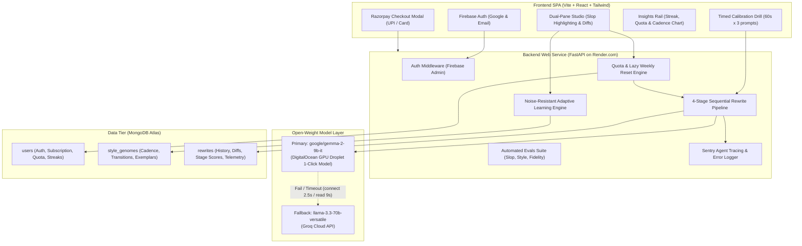

# InkFlow: Master Architecture & Project Execution Plan

> **Project Name**: InkFlow  
> **Repository Root**: `C:\InkFlow`  
> **Documentation Directory**: `C:\InkFlow\docs`  
> **Theme**: Hacktoberfest 2026 Challenge 3 — Side Hustle (Open-Source AI Core)  
> **Target Audience**: University students, researchers, professors, office professionals (ages 20+)

---

## 1. Executive Summary & Core Value Proposition

InkFlow is an adaptive writing twin and anti-AI-slop studio. While generic humanizers rely on simplistic synonym replacement or artificial typos that flatten personal voice, InkFlow captures an individual’s authentic **Style DNA** via a 3-minute timed situational onboarding drill. It rewrites drafts into the user's authentic cadence, guards core factual claims via an automated meaning gate with reason-aware retries, refines syntax while preserving personal punctuation quirks, and adaptively evolves over time using a noise-resistant recurrence filter.

### Why Open-Source AI is Essential to InkFlow:
1. **Absolute Data Sovereignty**: Personal emails, workplace memos, and unique stylistic fingerprints are never sent to closed corporate AI training pipelines. InkFlow runs on self-hosted open weights (**Google Gemma 2 9B-IT** on a private DigitalOcean GPU Droplet) with zero data retention.
2. **Uncensored Stylistic Steerability**: Commercial closed models force a homogenized, corporate-safe RLHF tone ("delve", "it is important to note"). Open-weight Gemma 2 respects natural sentence fragments, authentic informal transitions, and variable burstiness without synthetic flattening.
3. **Viable Side Hustle Unit Economics**: Fixed, predictable infrastructure costs (DigitalOcean GPU + free Groq tier fallback) make a $9/month or lifetime pricing model profitable, where proprietary per-token API fees would destroy margins.

---

## 2. End-to-End System Architecture

---

## 3. Hackathon Sponsor Tracks & Prize Alignment

| Partner Category | Target Prize | InkFlow Technical Implementation |
| :--- | :--- | :--- |
| **Best Use of Render** | **$200 USD** | Production FastAPI backend web service deployed and orchestrated on Render.com (`render.yaml`). |
| **Best Use of MongoDB Atlas** | **$100 USD** | Flexible document database storing nested `style_genomes`, evolution logs, diff buffers, and rewrite histories. |
| **Best Use of Sentry Agent Tracing** | **$100 USD** | Full tracing across all 4 pipeline stages (Stage 1-4 latency, fallback activations, eval scores, and `groq_rate_limit_429` alerts). |
| **Best Use of a .tech Domain** | **$100 USD** | Production web application mapped to a free Hacktoberfest `.tech` domain (e.g. `inkflow.tech`). |
| **Best Use of ElevenLabs** *(Bonus)* | **$100 USD** | Voice narration generated for the video walkthrough and demo submission. |

---

## 4. Work Breakdown & Division of Labor

As agreed, the project is structured with clear ownership:

### Phase 1: Backend Engineering (Day 1 - Day 2)
*Owner: User*
- [ ] Initialize Python environment, `requirements.txt`, and FastAPI structure.
- [ ] Implement `app/core/config.py` and MongoDB Atlas connection via Motor.
- [ ] Build resilient `generate_llm_completion()` with DigitalOcean Gemma 2 primary (`connect=2.5s`, `read=9.0s`) and Groq Llama 3.3 fallback.
- [ ] Build 4-stage sequential pipeline with reason-aware Stage 3 retry and soft warning fallback.
- [ ] Build lazy weekly quota reset engine (`wordsUsedThisWeek` / `weeklyWordLimit`).
- [ ] Implement noise-resistant adaptive learning engine ($\ge 3$ cross-session recurrence).
- [ ] Implement Sentry Agent Tracing and automated test suite (`pytest`).
- [ ] Deploy backend to Render.com.

### Phase 2: Frontend Engineering (Day 2 - Day 3)
*Owner: Friend*
- [ ] Initialize Vite + React (TypeScript) + Tailwind CSS following `docs/frontend.md`.
- [ ] Implement Wispr Flow design system (warm porcelain `#FAF9F6`, amber CTAs, rounded-3xl surfaces).
- [ ] Build Left Dock navigation and Right Stats & Quota rail.
- [ ] Build the 60-second Timed Calibration Drill with Framer Motion animations.
- [ ] Build the Dual-Pane Transformation Studio with live slop detection, diff viewer, and progressive loading states.
- [ ] Integrate Firebase Auth (Google Sign-In) and Razorpay checkout modal.
- [ ] Connect to Render backend API endpoints and verify end-to-end flows.

---

## 5. Risk Assessment & Mitigations

| Identified Risk | Severity | Engineered Mitigation |
| :--- | :--- | :--- |
| **DigitalOcean GPU Droplet Cold/Offline** | Medium | Resilient client automatically fails fast (`connect=2.5s`) to Groq Llama 3.3, logging a warning to Sentry without disrupting the user. |
| **Slow Gemma Inference Latency (6–9s)** | Low | Progressive loading state cycles honest micro-copy ("Matching cadence...", "Injecting voice...", "Verifying facts..."), turning wait time into perceived craftsmanship. |
| **Meaning Drift on Complex Inputs** | Medium | Stage 3 injects the exact `drift_reason` into an automated retry; if it still fails, returns output with a soft warning badge (`meaningCheckFailed: true`) so the demo never crashes. |
| **Genome Instability from Isolated Edits** | Low | Recurrence filter ignores one-off typo edits; requires $\ge 3$ session occurrences before shifting Style Genome parameters. |
| **Quota Reset Maintenance Overhead** | Low | In-flight lazy calculation resets `wordsUsedThisWeek` on the first request of each calendar week (Monday 00:00 UTC) with zero cron dependencies. |
